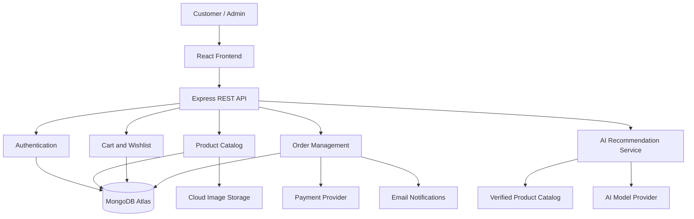

# 🧸 TOYJOY 2.0

### AI-Powered Toy Shopping & Personalized Gift Discovery Platform

> **Discover the Perfect Toy. Find the Perfect Gift. Make Every Moment Special.**

<div align="center">

[](https://toyjoy-puce.vercel.app/)


**A Modern E-Commerce Experience for Toys, Educational Products, and Personalized Gifts.**

[Live Store](https://toyjoy-puce.vercel.app/) · [GitHub](https://github.com/Mugunthandk) · [LinkedIn](https://www.linkedin.com/in/mugunthandk/)

⭐ If you like this project, give the repository a star!

</div>

---

## 📖 1. Project Overview

**ToyJoy 2.0** is a modern toy-shopping platform designed to make discovering, comparing, and purchasing toys simple, enjoyable, and personalized.

The platform combines a responsive storefront with product discovery, shopping cart management, wishlist functionality, and a vision for AI-powered toy recommendations.

ToyJoy aims to go beyond a traditional online toy store by helping customers find age-appropriate products, discover educational toys, explore personalized gift ideas, and make informed purchasing decisions.

### 🎯 Project Objectives

- Build a premium, responsive toy e-commerce experience.
- Simplify product discovery through search and filtering.
- Help customers find toys based on age, interests, and budget.
- Provide convenient cart, wishlist, and checkout workflows.
- Introduce AI-assisted gift recommendations.
- Establish a foundation for inventory and order management.
- Support future administrative analytics and personalization.

---

## ✨ 2. Core Features

### 🛍️ Smart Product Discovery

- Browse toys through organized categories.
- View product images, descriptions, and prices.
- Search, sort, and filter products.
- Explore featured products and best sellers.
- Discover trending toys and new arrivals.
- Compare products before purchasing.
- View customer ratings and reviews where available.
- Access responsive product detail pages.
- Explore recently viewed products where supported.

### 🧠 AI-Powered Toy Recommendations

**Planned capability:** Recommend products based on customer preferences and verified catalog information.

- Age-range-based toy discovery.
- Interest-based recommendations.
- Budget-aware gift suggestions.
- Educational toy discovery.
- Birthday and celebration gift ideas.
- Conversational shopping assistance.
- Explanations for recommended products.

### ❤️ Wishlist Management

- Save favorite toys.
- Remove unwanted items.
- Review saved products.
- Move products to the shopping cart.
- Synchronize saved items when account functionality is implemented.

### 🛒 Shopping Cart

- Add and remove products.
- Update quantities.
- Calculate item subtotals.
- Display order totals.
- Apply eligible discounts.
- Validate stock and prices before checkout.
- Preserve cart state where supported.

### 💳 Checkout & Order Management

**Planned full-stack capabilities**

- Customer details and delivery addresses.
- Order summary and pricing breakdown.
- Coupon validation.
- Payment gateway integration.
- Order confirmation.
- Order history.
- Order cancellation according to configured rules.
- Shipment status tracking.

Real payments and persistent order management require a configured backend and verified integrations.

### 🛠️ Admin Dashboard

**Future enhancement**

- Product creation and editing.
- Category management.
- Inventory updates.
- Low-stock alerts.
- Order processing.
- Coupon management.
- Customer support workflows.
- Sales and revenue analytics.
- Downloadable reports.

### 📱 Performance & Accessibility

- Responsive layouts for desktop, tablet, and mobile.
- Reusable React components.
- Optimized images and lazy loading.
- Efficient production builds.
- Loading skeletons and error states.
- Accessible forms and keyboard navigation.
- SEO-friendly page metadata.
- Optional light and dark themes.

---

## 🤖 3. AI Gift Finder

The AI Gift Finder is a planned intelligent shopping assistant that helps customers select toys based on age range, interests, occasion, and budget.

### Example interaction

**Customer:**

"Find educational toys for a 7-year-old child under ₹1,500 who enjoys science and building things."

**Potential assistant response:**

- Matching educational toys from the available catalog.
- Current product prices and availability.
- Age suitability based on verified product information.
- An explanation of why each toy matches the request.
- Direct links to product details.
- An option to add a selected toy to the cart.

### Recommendation workflow

```text
          CUSTOMER PREFERENCES
                   |
                   v
        Age + Interests + Budget
                   |
                   v
          PRODUCT CATALOG SEARCH
                   |
                   v
        FILTER AVAILABLE PRODUCTS
                   |
                   v
         AI RECOMMENDATION SERVICE
                   |
                   v
       VALIDATE PRODUCT INFORMATION
                   |
                   v
        PERSONALIZED GIFT RESULTS
                   |
                   v
           VIEW / ADD TO CART
```

### AI implementation principles

- Keep private API credentials on the backend.
- Ground recommendations in actual catalog records.
- Validate all recommended product identifiers.
- Never invent prices, stock, or product specifications.
- Respect age suitability and product safety information.
- Protect children's personal information.
- Provide standard search as a fallback when AI is unavailable.

**Status:** AI integration remains a planned feature unless a working implementation has been configured and tested.

---

## 🎁 4. Personalized Shopping Experience

ToyJoy can evolve into a personalized gift-discovery platform through the following workflows.

### Age-based discovery

Help customers find products appropriate for a selected age range using verified product labels.

### Interest-based discovery

Organize recommendations around interests such as:

- Science and experiments.
- Building and construction.
- Arts and crafts.
- Puzzles and problem-solving.
- Outdoor activities.
- Board games.
- Creative learning.

### Budget-based gift finder

Allow customers to enter a budget and discover matching products without exceeding the requested price range.

### Occasion-based shopping

Organize products for birthdays, celebrations, holidays, and special gifting occasions.

These personalization workflows can begin with rule-based catalog filtering before adding an AI model.

---

## 🏗️ 5. System Architecture

The following is a proposed architecture for a full-stack implementation.



### Architecture principles

- Separate presentation, business logic, and persistence.
- Validate all incoming requests.
- Enforce authentication and authorization on the server.
- Verify payment results before marking orders as paid.
- Keep API keys and database credentials out of client code.
- Ground AI recommendations in verified product data.
- Use reliable order processing and error handling.

---

## 🛠️ 6. Technology Stack

### Frontend foundation

| Technology | Purpose |
|---|---|
| React 19 | Component-based interface |
| Vite 7 | Development and build tooling |
| JavaScript ES6+ | Application logic |
| Tailwind CSS 4 | Responsive styling |
| Vercel | Frontend deployment |

### Proposed full-stack extensions

| Technology | Purpose |
|---|---|
| Node.js | Backend runtime |
| Express.js | REST APIs |
| MongoDB Atlas | Cloud database |
| Firebase Authentication or JWT | Authentication |
| Gemini API | AI shopping assistant |
| Cloudinary | Product image storage |
| Razorpay | Payment integration |
| Recharts | Admin analytics |
| Vitest | Unit testing |
| Playwright | End-to-end testing |
| Render | Backend hosting |

The proposed integrations are not confirmed installed dependencies. Update this section as each technology is implemented.

---

## 📂 7. Project Structure

Example frontend structure:

```text
ToyJoy/
├── public/
│   ├── images/
│   └── favicon.svg
├── src/
│   ├── assets/
│   ├── components/
│   │   ├── common/
│   │   ├── layout/
│   │   ├── products/
│   │   └── cart/
│   ├── pages/
│   ├── hooks/
│   ├── context/
│   ├── services/
│   ├── data/
│   ├── utils/
│   ├── styles/
│   ├── App.jsx
│   └── main.jsx
├── tests/
├── .env.example
├── index.html
├── package.json
├── vite.config.js
└── README.md
```

### Proposed backend structure

```text
ToyJoy/
├── client/
│   └── src/
│       ├── components/
│       ├── pages/
│       ├── hooks/
│       ├── services/
│       └── context/
├── server/
│   └── src/
│       ├── config/
│       ├── controllers/
│       ├── middleware/
│       ├── models/
│       ├── routes/
│       ├── services/
│       ├── validators/
│       └── app.js
├── tests/
├── .env.example
└── README.md
```

Adapt these examples to the actual repository rather than replacing working files unnecessarily.

---

## ⚙️ 8. Getting Started

### Prerequisites

- Node.js compatible with the project.
- npm.
- Git.
- Visual Studio Code or another code editor.

### Installation

Clone your repository:

```bash
git clone YOUR_GITHUB_REPOSITORY_URL
cd ToyJoy
```

Install dependencies:

```bash
npm install
```

Start the development server:

```bash
npm run dev
```

Open the local URL shown by Vite, typically:

`http://localhost:5173`

### Production build

```bash
npm run build
```

### Preview production build

```bash
npm run preview
```

Confirm the actual repository URL and available npm scripts before running these commands.

---

## 🔐 9. Environment Configuration

For a future full-stack implementation, configure backend secrets in a server-side `.env` file.

Example `.env.example`:

```env
PORT=5000
NODE_ENV=development

MONGODB_URI=
JWT_SECRET=

GEMINI_API_KEY=

CLOUDINARY_CLOUD_NAME=
CLOUDINARY_API_KEY=
CLOUDINARY_API_SECRET=

RAZORPAY_KEY_ID=
RAZORPAY_KEY_SECRET=

CLIENT_URL=http://localhost:5173
EMAIL_API_KEY=
```

Use only the variables required by your actual implementation.

### Security checklist

- Never commit `.env` files.
- Never expose private API keys in frontend code.
- Use separate development and production credentials.
- Validate inputs and restrict administrative access.
- Verify payment signatures and webhook events.
- Store password hashes rather than plaintext passwords.
- Minimize collection of children's personal information.

---

## 🔌 10. Proposed API Design

| Method | Endpoint | Purpose |
|---|---|---|
| GET | `/api/products` | List products |
| GET | `/api/products/:id` | Retrieve product details |
| GET | `/api/categories` | List categories |
| POST | `/api/auth/register` | Register a customer |
| POST | `/api/auth/login` | Authenticate a customer |
| GET | `/api/users/me` | Retrieve the current profile |
| GET | `/api/cart` | Retrieve the shopping cart |
| POST | `/api/cart/items` | Add a cart item |
| GET | `/api/wishlist` | Retrieve saved products |
| POST | `/api/orders` | Create an order |
| GET | `/api/orders` | Retrieve customer orders |
| POST | `/api/ai/recommendations` | Request toy recommendations |
| POST | `/api/payments/verify` | Verify payment status |
| GET | `/api/admin/analytics` | Retrieve authorized analytics |

These endpoints are proposed API contracts, not confirmed live endpoints.

---

## 🗄️ 11. Database Design

The proposed MongoDB data model may include:

| Collection | Purpose |
|---|---|
| Users | Customer and administrator accounts |
| Products | Toy details, pricing, categories, age range, and stock |
| Categories | Product classification |
| Carts | Customer shopping cart |
| Wishlists | Saved products |
| Orders | Order details and status |
| Reviews | Customer ratings and comments |
| Coupons | Discount rules and expiry |

### Data integrity

- Store monetary values consistently.
- Recalculate totals using trusted database prices.
- Validate inventory before order confirmation.
- Preserve price snapshots in order records.
- Restrict customers to their own orders.
- Index frequently searched product fields.
- Verify payment events before marking orders as paid.

---

## 🛡️ 12. Security & Reliability

A production-ready implementation should include:

- Input validation and safe error handling.
- Secure password hashing.
- Server-side role-based access control.
- Rate limiting on sensitive endpoints.
- CORS configuration for trusted origins.
- Payment signature verification.
- Duplicate-order prevention.
- Safe image upload validation.
- Appropriate logging without exposing secrets.
- Privacy-conscious customer data handling.
- Age-appropriate product information.

Never trust client-submitted prices, discounts, inventory counts, roles, or payment statuses.

---

## 🧪 13. Testing Strategy

### Recommended tools

- **Vitest:** Unit tests.
- **React Testing Library:** Component tests.
- **Playwright:** End-to-end tests.

### Testing checklist

- [ ] Product search and filtering.
- [ ] Sorting and product comparison.
- [ ] Cart quantities and totals.
- [ ] Invalid input handling.
- [ ] Authentication and authorization.
- [ ] Out-of-stock product handling.
- [ ] Payment success and failure.
- [ ] Duplicate payment event handling.
- [ ] Admin endpoint authorization.
- [ ] Responsive layouts and accessibility.

Example commands, once the corresponding scripts are configured:

```bash
npm run build
npm run test
npx playwright test
```

---

## 🚀 14. Deployment

### Frontend deployment with Vercel

1. Push the project to GitHub.
2. Import the repository into Vercel.
3. Configure the frontend root directory.
4. Set the build command to `npm run build`.
5. Configure the Vite output directory, usually `dist`.
6. Add required public environment variables.
7. Deploy and test the production website.

**Live website:** [toyjoy-puce.vercel.app](https://toyjoy-puce.vercel.app/)

### Backend deployment with Render

When the backend is implemented:

1. Create a backend web service.
2. Configure build and start commands.
3. Add server-side environment variables.
4. Configure MongoDB Atlas connectivity.
5. Restrict CORS to trusted frontend origins.
6. Test API responses and error handling.
7. Verify payment processing before enabling real payments.

---

## 🗺️ 15. Development Roadmap

The following items are planned enhancements unless already implemented and verified.

### Phase 1: Shopping Experience

- [x] Initial React-based ToyJoy website.
- [x] Responsive UI foundation.
- [ ] Complete product detail experience.
- [ ] Advanced search and filtering.
- [ ] Persistent cart and wishlist.

### Phase 2: Full-Stack Foundation

- [ ] Express.js backend.
- [ ] MongoDB integration.
- [ ] Customer authentication.
- [ ] Product and category APIs.
- [ ] Inventory management.

### Phase 3: E-Commerce

- [ ] Customer accounts and addresses.
- [ ] Checkout and order management.
- [ ] Payment gateway integration in test mode.
- [ ] Order confirmation notifications.
- [ ] Order tracking.

### Phase 4: AI & Personalization

- [ ] AI-powered shopping assistant.
- [ ] Catalog-grounded recommendations.
- [ ] Personalized Gift Finder.
- [ ] Age and interest-based discovery.
- [ ] Recommendation quality evaluation.

### Phase 5: Production Readiness

- [ ] Admin analytics dashboard.
- [ ] Automated testing.
- [ ] Accessibility audit.
- [ ] Performance optimization.
- [ ] Security review.
- [ ] Production deployment verification.

Mark features complete only after their implementation has been tested.

---

## 📈 16. Business Value

With the appropriate backend and analytics integrations, ToyJoy could help a business understand:

- Best-selling toys.
- Popular product categories.
- Average order value.
- Customer engagement.
- Repeat purchase patterns.
- Inventory movement.
- Coupon performance.
- Gift recommendation relevance.

These are potential analytics capabilities, not measured business results.

---

## 🤝 17. Contributing

Contributions, bug reports, and feature suggestions are welcome.

1. Fork the repository.
2. Create a feature branch:

   ```bash
   git checkout -b feature/your-feature
   ```

3. Implement and test your changes.
4. Commit your work:

   ```bash
   git commit -m "feat: add your feature"
   ```

5. Push your branch:

   ```bash
   git push origin feature/your-feature
   ```

6. Open a pull request describing your changes.

---

## 👨‍💻 18. Developer

### Mugunthan DK

**Full Stack Developer | AI/ML Enthusiast**

B.Tech Information Technology, VSB Engineering College

- **Live Project:** [ToyJoy 2.0](https://toyjoy-puce.vercel.app/)
- **GitHub:** [Mugunthandk](https://github.com/Mugunthandk)
- **LinkedIn:** [Mugunthan DK](https://www.linkedin.com/in/mugunthandk/)
- **Portfolio:** [Personal Portfolio](https://mugunthandk-portfolio-vvuy.vercel.app/)

Interested in building scalable web applications, AI-powered products, and practical software solutions.

---

## 📜 19. License

Add an appropriate `LICENSE` file before describing the repository as open source or permitting redistribution.

---

<div align="center">

# 🧸 TOYJOY 2.0

### Discover. Explore. Play.

**Every gift can create a lasting memory. 🎁**

[Visit the Live Store](https://toyjoy-puce.vercel.app/)

Built with ❤️ by **Mugunthan DK**

⭐ Star the repository if you like the project!

</div>
