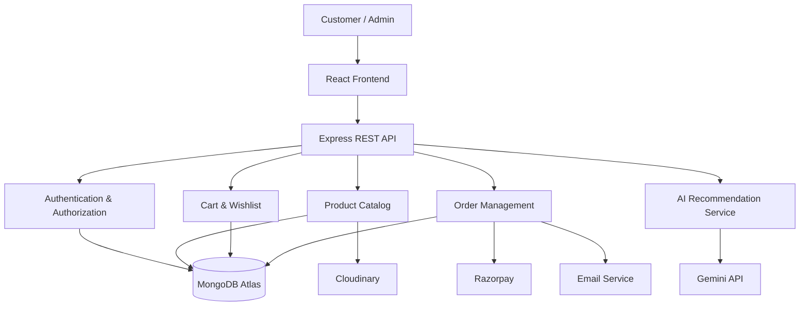

# 🧸 ToyJoy 2.0
### AI-Powered Toy Shopping & Personalized Gift Discovery Platform

<div align="center">

**A modern, intelligent, and responsive e-commerce experience built for the next generation of toy shopping.**

[🌐 Live Demo](https://toyjoy-puce.vercel.app/) • [💻 GitHub Repository](https://github.com/Mugunthandk) • [👨‍💻 Developer](https://www.linkedin.com/in/mugunthandk/)


</div>

---

## 📌 Table of Contents

- [Overview](#-overview)
- [Vision](#-vision)
- [Key Features](#-key-features)
- [AI-Powered Shopping](#-ai-powered-shopping)
- [Technology Stack](#-technology-stack)
- [System Architecture](#-system-architecture)
- [Project Structure](#-project-structure)
- [Getting Started](#-getting-started)
- [Environment Variables](#-environment-variables)
- [API Design](#-api-design)
- [Database Design](#-database-design)
- [Security](#-security)
- [Testing](#-testing)
- [Deployment](#-deployment)
- [Roadmap](#-development-roadmap)
- [Contributing](#-contributing)
- [Developer](#-developer)
- [License](#-license)

---

## 🚀 Overview

**ToyJoy 2.0** is a modern toy e-commerce platform designed to make discovering, comparing, and purchasing toys simple, enjoyable, and personalized.

The platform combines a responsive shopping experience with product discovery, wishlist management, shopping cart functionality, and a planned AI-powered recommendation system.

ToyJoy aims to go beyond a traditional online toy store by helping customers discover age-appropriate toys, explore gift ideas, compare products, and make informed purchasing decisions.

### 🎯 Project Goals

- Deliver a premium, responsive e-commerce experience.
- Simplify product discovery through intelligent search and filtering.
- Provide a convenient shopping cart, wishlist, and checkout experience.
- Introduce AI-assisted toy recommendations.
- Enable administrators to manage products, inventory, and orders.
- Apply full-stack engineering, security, testing, and deployment practices.

---

## ✨ Key Features

### 🛍️ Customer Shopping Experience

- Modern homepage with featured products and special offers.
- Dynamic product catalog and category browsing.
- Product detail pages with images, descriptions, and pricing.
- Search, sorting, and advanced product filtering.
- Shopping cart and wishlist management.
- Best sellers, trending toys, and new arrivals.
- Product ratings and customer reviews.
- Recently viewed products.
- Product comparison.
- Responsive navigation and mobile-friendly layouts.

### 🤖 AI-Powered Toy Recommendations

Planned AI capabilities designed to help customers find suitable toys based on their preferences.

- Personalized toy discovery.
- Recommendations based on age range and interests.
- Budget-aware gift suggestions.
- Occasion-based recommendations for birthdays and celebrations.
- Conversational shopping assistant.
- Explanations for recommended products.
- Catalog-grounded recommendations rather than invented products.

### 👤 User Accounts

- Customer registration and login.
- Profile management.
- Saved delivery addresses.
- Order history.
- Wishlist synchronization.
- Order status tracking.
- Account and session management.

### 🛒 Checkout and Orders

- Persistent shopping cart.
- Delivery address selection.
- Coupon and discount validation.
- Checkout summary.
- Payment gateway integration using test mode.
- Order confirmation.
- Order cancellation according to configured rules.
- Order history and shipment tracking.

### 🛠️ Admin Dashboard

Planned administrative capabilities:

- Product creation, editing, and deletion.
- Category management.
- Inventory management.
- Low-stock alerts.
- Order processing.
- Coupon and promotion management.
- Customer management with role-based permissions.
- Sales analytics and revenue charts.
- Downloadable reports.

### ⚡ Performance and Accessibility

- Responsive design for desktop, tablet, and mobile.
- Reusable React components.
- Lazy-loaded images.
- Optimized production builds.
- Loading skeletons and error states.
- Accessible forms and keyboard navigation.
- SEO-friendly page metadata.
- Light and dark themes.

---

## 🧠 AI-Powered Shopping

ToyJoy's planned AI shopping assistant uses customer preferences and actual catalog information to generate useful recommendations.

### Example workflow

1. The customer specifies an age range.
2. The customer selects interests and a budget.
3. The application retrieves matching products from the catalog.
4. The AI service generates recommendations using those products.
5. The application validates recommended product identifiers.
6. The customer views product details and can add an item to the cart.

**Example request:**

> Find educational toys for a 7-year-old child under ₹1,500 who enjoys science and building things.

**Expected response:**

- Matching products from the available catalog.
- Product names, current prices, and availability.
- A short explanation of why each item matches.
- Links to the corresponding product pages.

### AI implementation principles

- Keep API credentials on the server.
- Use actual catalog records as the source of product information.
- Validate AI-generated recommendations before displaying them.
- Handle API failures and rate limits gracefully.
- Provide a non-AI fallback experience.
- Apply age-appropriate content and privacy protections.

*Note: AI integration depends on the backend and model API being configured and implemented.*

---

## 🛠️ Technology Stack

| Technology | Purpose |
|---|---|
| React 19 | Component-based user interface |
| Vite 7 | Development server and build tooling |
| JavaScript ES6+ | Application logic |
| Tailwind CSS 4 | Responsive styling |
| Framer Motion | Interface animations, if installed |
| Node.js | Backend JavaScript runtime |
| Express.js | REST API and business logic |
| MongoDB Atlas | Cloud database |
| Firebase Auth or JWT-based authentication | User authentication |
| Gemini API | AI shopping assistant |
| Cloudinary | Product image storage |
| Razorpay | Payment processing |
| Recharts | Dashboard analytics |
| Vitest | Unit testing |
| Playwright | End-to-end testing |
| Git and GitHub | Version control |
| Vercel | Frontend deployment |
| Render | Backend deployment |

The backend technologies listed above represent the proposed full-stack architecture. Use only the integrations that have actually been added to the repository.

---

## 🏗️ System Architecture



### Architecture principles

- Keep presentation, business logic, and persistence separate.
- Validate requests at the API boundary.
- Enforce authentication and permissions on the server.
- Verify payment results before confirming orders.
- Use environment variables for secrets and configuration.
- Keep AI recommendations grounded in verified product data.

---

## 📂 Project Structure

### Frontend

```text
ToyJoy/
├── public/
│   ├── images/
│   └── favicon.svg
├── src/
│   ├── assets/
│   ├── components/
│   │   ├── common/
│   │   ├── layout/
│   │   ├── products/
│   │   └── cart/
│   ├── pages/
│   ├── hooks/
│   ├── context/
│   ├── services/
│   ├── data/
│   ├── utils/
│   ├── styles/
│   ├── App.jsx
│   └── main.jsx
├── tests/
├── .env.example
├── index.html
├── package.json
├── vite.config.js
└── README.md
```

### Proposed full-stack structure

```text
ToyJoy/
├── client/
│   └── src/
│       ├── components/
│       ├── pages/
│       ├── hooks/
│       ├── services/
│       └── context/
├── server/
│   └── src/
│       ├── config/
│       ├── controllers/
│       ├── middleware/
│       ├── models/
│       ├── routes/
│       ├── services/
│       ├── validators/
│       ├── utils/
│       └── app.js
├── tests/
├── .env.example
├── package.json
└── README.md
```

Adapt these examples to match the actual repository. The proposed `client/` and `server/` structure is appropriate when the backend is introduced.

---

## ⚙️ Getting Started

### Prerequisites

Install the following tools:

- Node.js compatible with your Vite version.
- npm.
- Git.
- A code editor such as Visual Studio Code.

MongoDB Atlas and third-party API accounts are needed only for the corresponding integrations.

### 1. Clone the repository

```bash
git clone https://github.com/Mugunthandk/ToyJoy.git
```

```bash
cd ToyJoy
```

Ensure the repository URL matches the actual GitHub repository.

### 2. Install dependencies

```bash
npm install
```

### 3. Start the development server

```bash
npm run dev
```

### 4. Open the website

Visit the local URL displayed by Vite, usually:

```text
http://localhost:5173
```

### 5. Create a production build

```bash
npm run build
```

### 6. Preview the production build

```bash
npm run preview
```

Check `package.json` for the available scripts before running these commands.

---

## 🔐 Environment Variables

For a frontend-only version, a backend environment file may not be necessary.

For the proposed full-stack version, create a `.env` file inside the server directory.

```env
PORT=5000
NODE_ENV=development

MONGODB_URI=your_mongodb_connection_string

JWT_SECRET=your_long_random_secret

GEMINI_API_KEY=your_gemini_api_key

CLOUDINARY_CLOUD_NAME=your_cloud_name
CLOUDINARY_API_KEY=your_cloudinary_api_key
CLOUDINARY_API_SECRET=your_cloudinary_api_secret

RAZORPAY_KEY_ID=your_test_key_id
RAZORPAY_KEY_SECRET=your_test_key_secret

CLIENT_URL=http://localhost:5173

EMAIL_API_KEY=your_email_provider_api_key
```

These variables are illustrative and must be matched to the actual backend implementation.

### Environment security

- Never commit `.env` files.
- Add `.env` to `.gitignore`.
- Keep private API keys exclusively on the server.
- Use separate credentials for development and production.
- Configure environment variables in your hosting provider.
- Provide an `.env.example` file with placeholder values.

**Important:** Vite exposes variables prefixed with `VITE_` to client-side code. Never put private API keys in those variables.

---

## 🔌 API Design

The following REST API structure is proposed for the full-stack version.

| Method | Endpoint | Purpose |
|---|---|---|
| GET | `/api/products` | List products |
| GET | `/api/products/:id` | Get product details |
| GET | `/api/categories` | List categories |
| POST | `/api/auth/register` | Register a customer |
| POST | `/api/auth/login` | Authenticate a customer |
| GET | `/api/users/me` | Get the current profile |
| GET | `/api/cart` | Retrieve the cart |
| POST | `/api/cart/items` | Add a cart item |
| GET | `/api/wishlist` | Retrieve the wishlist |
| POST | `/api/orders` | Create an order |
| GET | `/api/orders` | Retrieve customer orders |
| POST | `/api/ai/recommendations` | Request toy recommendations |
| POST | `/api/payments/verify` | Verify a payment |
| GET | `/api/admin/analytics` | Retrieve authorized admin analytics |

These are design examples, not a claim that these endpoints currently exist.

All protected endpoints should enforce authentication and appropriate authorization.

---

## 🗄️ Database Design

The proposed MongoDB data model contains the following collections:

| Collection | Main fields |
|---|---|
| Users | name, email, password hash, role |
| Products | name, description, price, category, age range, stock |
| Categories | name, slug, description |
| Carts | user ID, product IDs, quantities |
| Wishlists | user ID, product IDs |
| Orders | user ID, items, totals, status, delivery details |
| Reviews | user ID, product ID, rating, comment |
| Coupons | code, discount, expiry, usage limits |

### Data integrity

- Store monetary values consistently.
- Validate product quantities and stock on the server.
- Recalculate order totals using trusted database prices.
- Prevent unauthorized access to other customers' orders.
- Store password hashes rather than plaintext passwords.
- Use database indexes for frequently searched fields.

---

## 🛡️ Security

ToyJoy should follow these security practices as the backend is implemented:

- Validate and sanitize incoming data.
- Use secure password hashing.
- Protect privileged routes with server-side role checks.
- Apply rate limiting to login and sensitive endpoints.
- Configure CORS for trusted origins.
- Avoid exposing stack traces and secrets in production errors.
- Verify payment signatures and webhook events.
- Make order creation and payment processing idempotent where appropriate.
- Validate image uploads and file types.
- Protect customer data and minimize unnecessary data collection.
- Keep dependencies updated and review security advisories.

Never trust client-submitted prices, discounts, roles, inventory counts, or payment statuses.

---

## 🧪 Testing

Recommended quality checks:

### Frontend

```bash
npm run build
```

### Unit tests

```bash
npm run test
```

### End-to-end tests

```bash
npx playwright test
```

The test commands above require corresponding scripts and testing dependencies to be configured.

### Essential test scenarios

- Product search returns expected results.
- Filters and sorting work correctly.
- Cart quantities and totals are accurate.
- Invalid inputs display clear error messages.
- Authentication and authorization behave correctly.
- Out-of-stock products cannot be purchased.
- Failed payments do not create falsely paid orders.
- Admin endpoints reject unauthorized users.
- Responsive layouts work across supported screen sizes.

---

## 🚀 Deployment

### Frontend: Vercel

1. Push the code to GitHub.
2. Import the repository into Vercel.
3. Configure the frontend root directory.
4. Set the build command to `npm run build`.
5. Configure the correct output directory for Vite, usually `dist`.
6. Add only the required frontend environment variables.
7. Deploy and verify the production URL.

Live website: https://toyjoy-puce.vercel.app/

### Backend: Render

1. Create a web service using the backend repository or directory.
2. Configure the build and start commands.
3. Add the required server environment variables.
4. Configure MongoDB Atlas network access securely.
5. Set the frontend origin in the CORS configuration.
6. Test the health endpoint, API responses, and error handling.
7. Confirm payment verification and webhook configuration before enabling real payments.

Never enable production payment processing until verification, error handling, and order integrity have been tested.

---

## 🗺️ Development Roadmap

### Phase 1: Core Shopping Experience

- [x] Initial React-based ToyJoy website
- [x] Responsive UI foundation
- [ ] Complete product detail experience
- [ ] Advanced search and filtering
- [ ] Persistent cart and wishlist

### Phase 2: Full-Stack Foundation

- [ ] Express.js backend
- [ ] MongoDB integration
- [ ] Authentication and authorization
- [ ] Product and category APIs
- [ ] Inventory management

### Phase 3: Commerce

- [ ] Customer accounts and addresses
- [ ] Checkout and order management
- [ ] Razorpay test-mode integration
- [ ] Order confirmation emails
- [ ] Order tracking

### Phase 4: AI and Personalization

- [ ] Gemini-powered shopping assistant
- [ ] Catalog-grounded product recommendations
- [ ] Gift Finder
- [ ] Personalized product discovery
- [ ] Recommendation quality evaluation

### Phase 5: Production Readiness

- [ ] Admin analytics dashboard
- [ ] Automated test coverage
- [ ] Accessibility audit
- [ ] Performance optimization
- [ ] Security review
- [ ] Production deployment verification

*Roadmap items should be marked complete only after the corresponding functionality has been implemented and verified.*

---

## 🤝 Contributing

Contributions, bug reports, and feature suggestions are welcome.

1. Fork the repository.
2. Create a feature branch.

   ```bash
   git checkout -b feature/your-feature
   ```

3. Make your changes and test them.
4. Commit your work.

   ```bash
   git commit -m "feat: add your feature"
   ```

5. Push the branch.

   ```bash
   git push origin feature/your-feature
   ```

6. Open a pull request describing your changes.

---

## 👨‍💻 Developer

### Mugunthan DK

**Full Stack Developer | AI/ML Enthusiast**

B.Tech Information Technology, VSB Engineering College

- **Portfolio:** https://mugunthandk-portfolio-vvuy.vercel.app/
- **GitHub:** https://github.com/Mugunthandk
- **LinkedIn:** https://www.linkedin.com/in/mugunthandk/
- **Live Project:** https://toyjoy-puce.vercel.app/

Interested in building scalable web applications, AI-powered products, and practical software solutions.

---

## 📜 License

This project does not yet specify a license. Add an appropriate `LICENSE` file before describing the repository as open source or permitting redistribution.

---

<div align="center">

### 🧸 ToyJoy 2.0

**Discover. Explore. Play.**

Built with ❤️ by **Mugunthan DK**

[Live Demo](https://toyjoy-puce.vercel.app/) • [GitHub](https://github.com/Mugunthandk)

</div>
